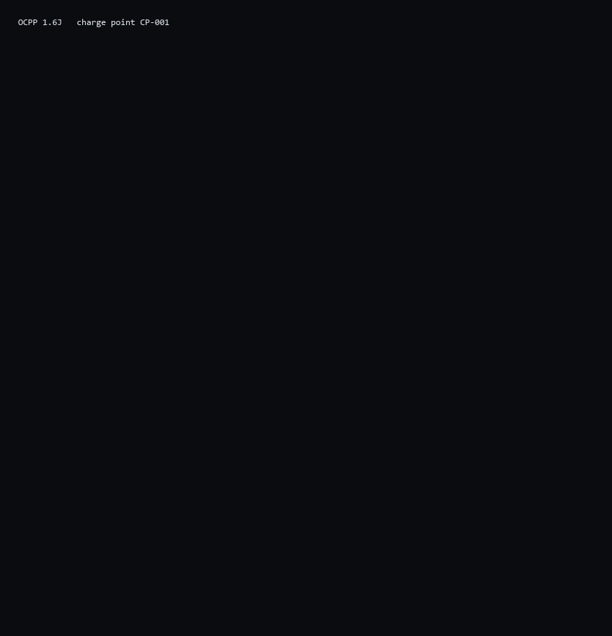

# OCPP

OCPP 1.6J 和 2.0.1 的 MoonBit 实现。给充电桩和后台之间那段 WebSocket 对话一个不依赖 Node、不依赖 JVM 的库：帧、报文、状态机，都在这里。



```json
[2, "CP-001-3", "StartTransaction", {"connectorId": 1, "idTag": "TAG-1", "meterStart": 0, ...}]
[3, "CP-001-3", {"transactionId": 1, "idTagInfo": {"status": "Accepted"}}]
```

上面这两行是 `moon run cli -- demo` 的真实输出，不是示意。

## 覆盖范围

| 层 | 1.6J | 2.0.1 |
|---|---|---|
| 信封 | CALL / CALLRESULT / CALLERROR | 同左 |
| 启动 | BootNotification、Heartbeat | BootNotification、Heartbeat |
| 身份 | Authorize（idTag 字符串） | Authorize（idToken 对象） |
| 交易 | StartTransaction、StopTransaction | TransactionEvent（Started / Updated / Ended） |
| 计量 | MeterValues（sampledValue） | MeterValues（evse + sampledValue） |
| 状态 | StatusNotification（connector + errorCode） | StatusNotification（evse + connector） |
| 下发 | RemoteStart、RemoteStop、Reset | RequestStart、RequestStop、Reset |

不在表里的动作不会崩：桩侧回 `NotSupported`，后台侧回 `NotImplemented`，两边都是合法的 CALLERROR。

## 跑起来

```bash
moon run cli -- demo          # 两个版本各跑一遍
moon run cli -- demo 2.0.1    # 只跑 2.0.1
moon run cli -- decode '[2,"1","Heartbeat",{}]'
moon run cli -- soak 50
```

`fixtures/` 里是从 demo 抄下来的完整报文，可以直接 `decode`。

## 目录

```
wire/     JSON-RPC 数组信封，三种消息类型与错误码
schema/   两侧共用：状态枚举、时间戳、JSON 读写
v16/      1.6J 的报文结构 + 动作表
v2/       2.0.1 的报文结构 + 动作表
station/  充电桩：连接器状态、电表、交易号
central/  后台：会话登记、鉴权、交易计数
sim/      脚本化的「桩 ↔ 后台」对话
cli/      命令行
```

依赖是单向的：`v16` / `v2` 依赖 `schema`，`station` 和 `central` 依赖两者，`sim` 才能同时看到两侧。桩不认识后台，后台也不认识桩——这条约束让两边都能独立测试。

## 两个设计选择

**版本不写在连接上。** 现场一台后台经常同时接 1.6 和 2.0.1 的桩，所以 `central` 靠报文形状区分：有 `chargingStation` 就是 2.0.1，有 `chargePointModel` 就是 1.6；`idToken` 对象对 `idTag` 字符串，`connectorStatus` 对 `status`。这样混合车队不需要按连接配置。

**sans-IO。** 所有方法返回「本该发出去的字符串」，不持有 socket。测试里可以把一次完整充电跑完，CLI 里可以直接打印，将来接 WebSocket 也只是把字符串写出去。

更多见 [`docs/architecture.md`](docs/architecture.md)，动作覆盖见 [`docs/protocol-coverage.md`](docs/protocol-coverage.md)。

## 边界

- 没有 WebSocket 传输层；本仓库只到报文为止。
- 1.6 的 Smart Charging、Firmware Management、Reservation 等扩展档位未实现。
- 2.0.1 的签名计量（signedMeterValue）、证书链、插头锁等未实现。
- 时间来自注入的时钟，不读系统时间，便于复现。

## 验证

```bash
moon check --deny-warn
moon test --deny-warn      # 37 个用例
moon fmt --check
```

测试覆盖信封合法性、两种报文的字段名、双方握手与完整交易流程，以及未知动作的处理。

## 许可

MIT，见 `LICENSE`。
