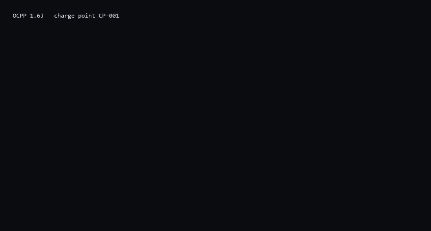

# OCPP

OCPP 1.6J 的 MoonBit 实现。给充电桩和后台之间那段 WebSocket 对话一个不依赖 Node、不依赖 JVM 的库：帧、报文、状态机，都在这里。

符合性目标：OCPP 1.6J 六功能块完整协议语义（28 条消息 + [docs/semantics.md](docs/semantics.md) 的状态与调度语义：Core、Firmware Management、Local Auth List、Reservation、Remote Trigger、Smart Charging）；宿主只承担硬件执行、持久化与网络传输。动作矩阵见 [docs/conformance.md](docs/conformance.md)，关联与交易推进见 [docs/correlation.md](docs/correlation.md)。

2.0.1 的旧代码不在 `master` 上，已归档到 `archive/ocpp-2.0.1` 分支，不参与构建与验收。



```json
[2, "CP-001-3", "StartTransaction", {"connectorId": 1, "idTag": "TAG-1", "meterStart": 0, ...}]
[3, "CP-001-3", {"transactionId": 1, "idTagInfo": {"status": "Accepted"}}]
```

上面这两行是 `moon run cli -- demo` 的真实输出，不是示意。

## 覆盖范围

| 功能块 | 动作 |
|---|---|
| 信封 | CALL / CALLRESULT / CALLERROR |
| Core | BootNotification、Heartbeat、Authorize、StartTransaction、StopTransaction、MeterValues、StatusNotification、RemoteStartTransaction、RemoteStopTransaction、ChangeConfiguration、GetConfiguration、ChangeAvailability、ClearCache、DataTransfer、UnlockConnector、Reset |
| Firmware Management | GetDiagnostics、DiagnosticsStatusNotification、FirmwareStatusNotification、UpdateFirmware |
| Local Auth List | GetLocalListVersion、SendLocalList |
| Reservation | ReserveNow、CancelReservation |
| Remote Trigger | RemoteTrigger |
| Smart Charging | SetChargingProfile、ClearChargingProfile、GetCompositeSchedule |

不在表里的动作不会崩：桩侧回 `NotSupported`，后台侧回 `NotImplemented`，两边都是合法的 CALLERROR。

## 跑起来

```bash
moon run cli -- demo
moon run cli -- decode '[2,"1","Heartbeat",{}]'
moon run cli -- soak 50
moon run cli -- dump
```

`fixtures/` 里是从 demo 抄下来的完整报文，可以直接 `decode`。

## 目录

```
wire/     JSON-RPC 数组信封，三种消息类型与错误码
schema/   共用：状态枚举、时间戳、JSON 读写
v16/      1.6J 的报文结构 + 动作表
station/  充电桩：连接器、电表、交易号、预约、本地名单、充电曲线
central/  后台：会话登记、鉴权、交易计数、下发命令
transport/传输接缝：方向信箱与 Correlator
sim/      脚本化的「桩 ↔ 后台」对话
cli/      命令行
```

依赖单向：`v16` 依赖 `schema`，`station` 和 `central` 依赖 `v16`，`sim` 才能同时看到两侧。桩不认识后台，后台也不认识桩。

## 两个设计选择

**版本写在连接上。** OCPP 在 WebSocket 握手的 `Sec-WebSocket-Protocol` 里协商版本，库把结果作为参数传入（`central.handle(V16, text)`），不靠报文形状判断。`Heartbeat` 是 `{}`，`Reset` 是 `{"type": ...}`，形状判别在这些报文上必然出错；当前只交付 1.6J。

**sans-IO。** 所有方法返回「本该发出去的字符串」，不持有 socket。测试里可以把一次完整充电跑完，CLI 里可以直接打印，接 WebSocket 时只把字符串写出去。

更多见 [docs/architecture.md](docs/architecture.md)、[docs/transport.md](docs/transport.md)，动作覆盖见 [docs/protocol-coverage.md](docs/protocol-coverage.md)，申报书见 [docs/proposal.md](docs/proposal.md)。

## 边界

- 没有 WebSocket 传输层；本仓库只到报文为止。
- 1.6 Security 扩展（证书、签名计量）不在目标内。
- Smart Charging 按 purpose 组合：ChargePointMaxProfile 是整桩上限，TxProfile 覆盖 TxDefaultProfile，composite 每段取 min 并按有效期/时段切分、到期回落；A/W 混用按桩电压换算；不做功率/三相计算。预约在连接器非 Available 或已有预约时返回 Occupied，不做插枪核对与超时释放。
- 时间来自注入的时钟，不读系统时间，便于复现。

## 验证

```bash
moon check --deny-warn
moon test --deny-warn      # 78 个用例
moon fmt --check
moon build --target wasm
```

测试覆盖信封合法性、28 条消息的字段与往返、版本绑定、关联超时、预约占用、多曲线组合、名单版本与未知动作处理。

## 许可

MIT，见 `LICENSE`。
